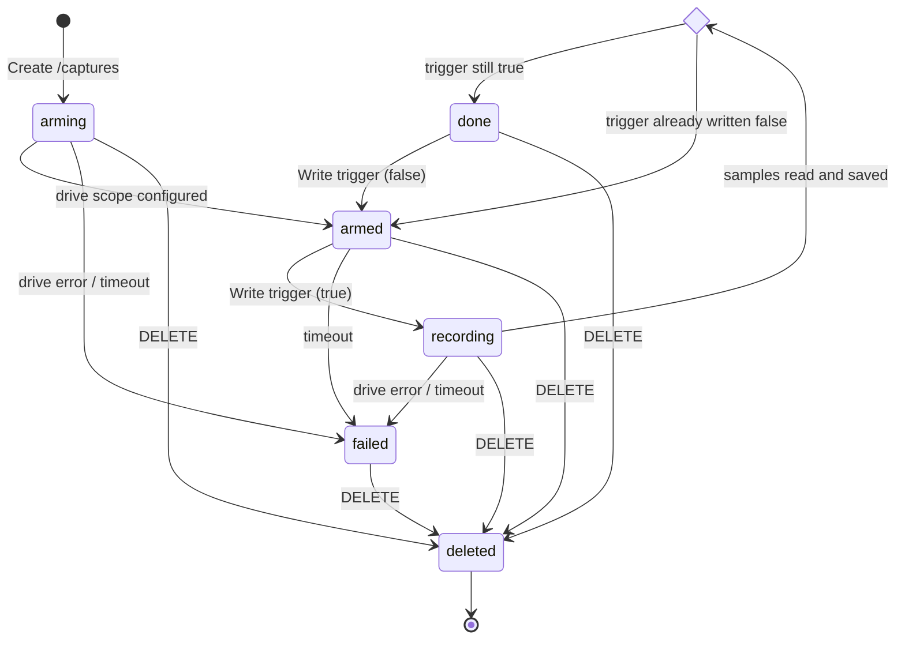
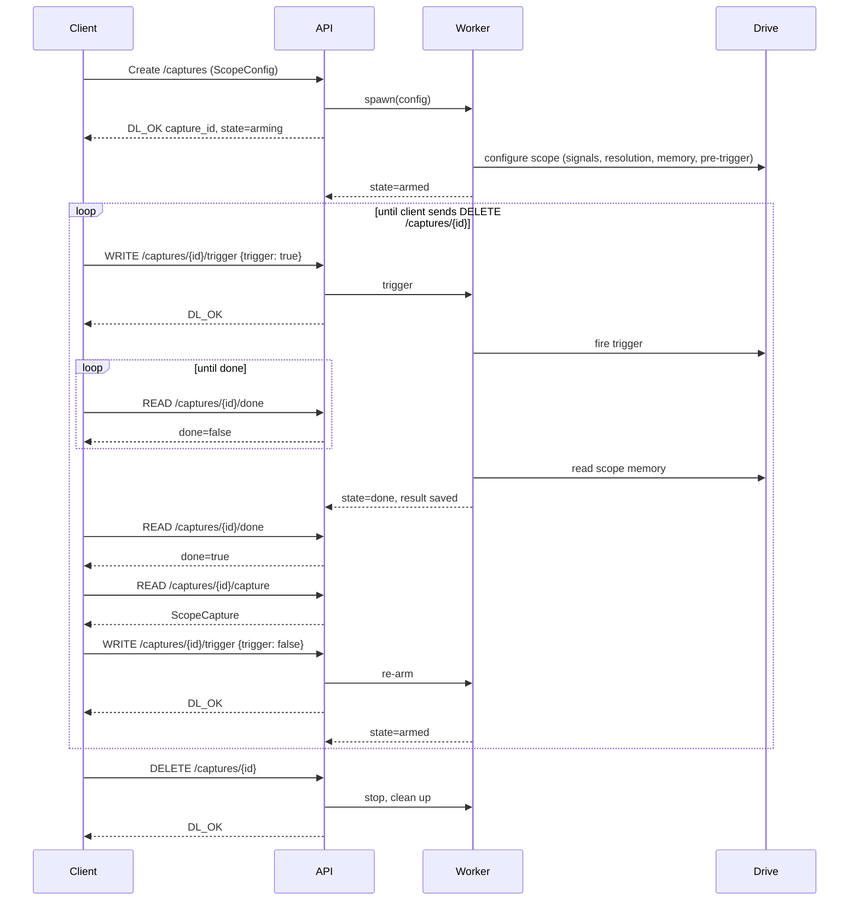

# Scope Capture Service — Design

## Purpose

An CtrlX OS service that runs oscilloscope captures on a drive. A client submits a create with
`ScopeConfig`, service spawns a new datalayer endpoint and returns the reference and then starts an oscope worker for the capture.
The client fires the trigger, then reads back the finished `ScopeCapture`. The client
deletes the capture when finished, which stops the worker and frees everything it
used.

## Schemas

The Config and Capture are defined as FlatBuffers schemas and are the source of truth for
field names and types. Do not redefine these structures by hand; generate code
from the schemas.

| Schema | Root type | Used for |
|---|---|---|
| `./designDocs/interface/scope_config.fbs` | `DriveCapture.ScopeConfig` | Request body when creating a capture |
| `./designDocs/interface/scope_capture.fbs` | `DriveCapture.ScopeCapture` | Result returned when the capture is done |

## Resource model

Each capture is one resource, identified by a server-generated `capture_id`
(UUID). One capture owns exactly one worker. A capture exists from the moment it
is created until the client deletes it.

## Endpoints

| Method | Path | Purpose |
|---|---|---|
| `CREATE` | `/captures` | Create a capture from a `ScopeConfig`, spawn its worker |
| `Read`   | `/captures/{capture_id}/ready`  | Oscope ready for trigger signal 
| `Write` | `/captures/{capture_id}/trigger` | Send the boolean trigger command |
| `READ` | `/captures/{capture_id}/done` | Poll whether the capture has finished |
| `READ` | `/captures/{capture_id}/capture` | Read the finished `ScopeCapture` |
| `DELETE` | `/captures/{capture_id}` | Stop the worker and clean up all resources |

### `Create /captures`

- Body: `ScopeConfig` as FlatBuffers binary
- Spawns the worker and returns immediately; it does not wait for the drive.
- `DL_OK` with `Location: /captures/{capture_id}`
- `DL_FAIL` for an invalid config or if another live capture already uses the same
  `drive_ip_address`.

### `Write /captures/{capture_id}/trigger`

- Body: `{ "trigger": true }`.
- `true` fires the trigger. Only Accepted once the oscope settings have been written to drive
- `DL_FAIL` if the oscope settings failed to write

### `Read /captures/{capture_id}/done`

- boolean value that is true when the last capture completes, set to false when a trigger is requested

### `Read /captures/{capture_id}/capture`

- Returns the `ScopeCapture`.
- `DL_FAIL` if the capture is not `done` yet.
- Reading is repeatable and does not change state.

### `DELETE /captures/{capture_id}`

- Allowed in every state, including while arming or recording.
- Stops the worker, releases the drive connection

## Capture lifecycle

| State | Meaning | Worker activity | Output|
|---|---|---|---|
| `arming` | Worker spawned, configuring the drive | Connects to drive, writes scope settings from the config | Ready = FALSE, Done = FALSE | 
| `armed` | Drive ready, waiting for the trigger | Idle, holding the drive connection| Ready = TRUE , Done = FALSE |
| `recording` | Trigger fired | Waits for the drive's scope memory to fill, then reads samples | Ready = False , Done = False| 
| `done` | Capture available | Result saved; worker exits, result stays until delete |Ready = False, Done = TRUE| 
| `failed` | Unrecoverable error or timeout | Worker exits; error message kept until delete | Ready = False, Done = False|
| `deleted` | Resource removed | Nothing; id no longer exists |

Rules:

- `measurement_timeout_ms` is measured from trigger. If the capture has not
  reached `done` by then, it moves to `failed` with a timeout error.
- `failed` is terminal apart from `DELETE`. Nothing is cleaned up
  automatically; resources live until the client deletes them.
- Only the worker changes a capture's state; Data Layer handlers send commands to the
  worker and read its state, they never modify it directly.

## Request flow

## Worker

- One worker per capture, running independently of the request that created
  it (task, thread, or process; implementation's choice).
- The API talks to a worker only through a command channel (`trigger`)
  and a state the worker publishes.
- Drive communication sits behind a `DriveClient` interface so the worker can be
  tested with a fake drive. The real protocol implementation is out of scope for
  this document.
- On `DELETE` the worker must release the drive connection and exit even if it is
  blocked waiting on the drive.

## Validation

Reject with `DL_FAIL` before spawning a worker:

- `drive_ip_address` is not a valid IPv4 address.
- `signals` is empty, or an entry is not a SERCOS IDN of the form
  `S-x-xxxx` / `P-x-xxxx`.
- `time_resolution_us`, `memory_size` or `measurement_timeout_ms` is 0.
- `pre_trigger_percent` is greater than 100.

## Resource cleanup

`DELETE` is the only cleanup path, and it must leave nothing behind:

- Worker stopped and joined.
- Drive connection closed.
- Capture files under `output_directory` deleted.
- In-memory entry for the `capture_id` removed.

If the service shuts down, it stops all workers and closes their drive
connections. Captures do not survive a restart.

## Out of scope

- Authentication and authorization, handled by CoreOS.
- Persisting captures across restarts.

